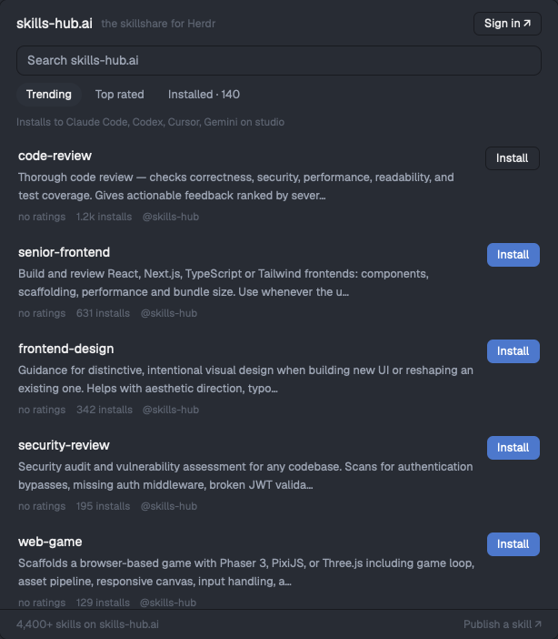

# skills-hub for Herdr

The skillshare for [Herdr](https://herdr.dev): browse, install and sync AI coding skills from [skills-hub.ai](https://skills-hub.ai/?utm_source=github&utm_medium=herdr-mod) without leaving your terminal workspace.



**Works in Herdr.** This is a Herdr app mod (`herdr-mod`). It shows up at herdr.dev/mods.

## What it does

- Search 4,400+ skills on skills-hub.ai, or browse **Trending** and **Top rated**. No account needed.
- Each card shows the name, a one-line description, rating and installs. Click the title to open the skill on skills-hub.ai.
- **Install** writes the skill for every AI tool on the machine: Claude Code, Codex, Cursor, Gemini, Windsurf, OpenCode, Cline, Roo, Augment, Continue and Junie (whichever have a config folder). Cards show Installed, Update or Install.
- **Installed** lists every skill on the machine with how many tools have it. **Sync to all tools** copies the newest version of each skill into every tool that lacks it or has an older one.
- Follows the focused space: if it lives on another machine, the panel scans and installs there.

## Install

Ask your agent in Herdr to add the mod from this repo, or copy it by hand:

```sh
git clone https://github.com/tinh2/herdr-skills-hub
cp -R herdr-skills-hub/mods/skills-hub ~/.config/herdr-app/mods/
herdr-app check ~/.config/herdr-app/mods/skills-hub
```

Open it from the command palette: **skills-hub: browse and install skills**.

The mod reaches the network (api.skills-hub.ai) and runs `sh` to read and write `~/<tool>/skills/<slug>/SKILL.md`. It writes nothing else.

## Develop

```sh
npm test
```

`mods/skills-hub/logic.js` holds the pure logic (URLs, SKILL.md format, scan, sync plan) and is tested with `node --test`.

## Related

- [skills-hub.ai](https://skills-hub.ai/?utm_source=github&utm_medium=herdr-mod): the catalog
- `npx @skills-hub-ai/cli install <slug>`: the same install from a shell

MIT licensed.
