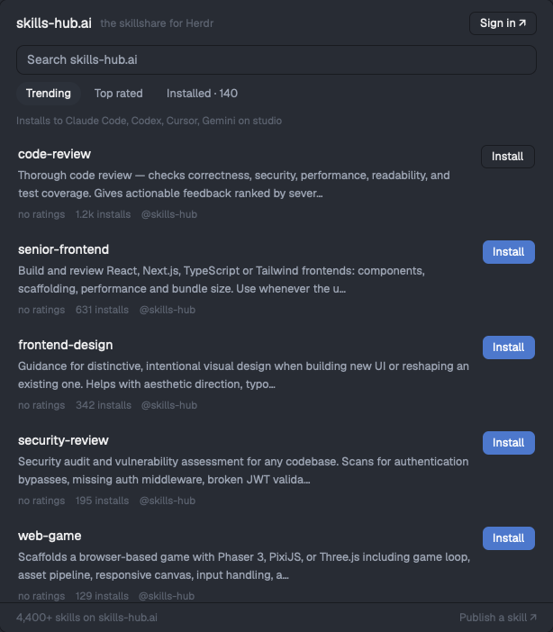

# skills-hub

A panel for finding and installing AI coding skills from skills-hub.ai. Search the catalog or browse Trending and Top rated, install a skill for every AI tool on the machine in one click, and keep all tools in sync from the Installed tab.

## What you see

A dialog 560×640 px (or a tab), on the theme's `surface`, ui font, top to bottom:

1. **Header**, 12px top padding: "skills-hub.ai" in 14px bold `foreground` (click opens the site), "the skillshare for Herdr" in 11px `dim`, and on the right a bordered "Sign in" button, or "@username" once signed in (click signs out).
2. **Search field**, 30px tall, 8px corners, 1px `border` (`accent` while typing), placeholder "Search skills-hub.ai".
3. **Tabs** as 24px pills: Trending, Top rated, Installed · N. The selected one has `selected` background. While a search is active no pill is selected and "Results for “query”" shows beside them.
4. **Status line**, 10.5px `dim`: "Installs to Claude Code, Codex, … on <machine>" (machine only when the focused space is remote), or "No AI coding tools found".
5. **List** that scrolls:
   - Catalog cards: name 13px semibold, description 11.5px `muted` (one line of up to 140 chars, wrapped), then "★ 4.5 (3)" or "no ratings", "1.2k installs", "@author" in 10.5px `dim`. A 24px button on the right: **Install** (`solid`), **Update** (`solid`), **Install** bordered when only some tools have it, **Installed** bordered and dim, **Installing…** while busy.
   - Installed rows: slug 12.5px medium with `vX` in `dim`, description one line, "k/n tools" (`blocked` color when some tool lacks it, hover lists the tools) and an **Update x.y.z** button when skills-hub.ai has a newer version. Above them: "N copies missing or older across tools" and a **Sync to all tools** button.
6. **Footer**, 30px, top border: the live total from `GET /skills/count` ("16,137 skills on skills-hub.ai", or "Loading…") and "Publish a skill ↗".

## How it behaves

- Opens on Trending. Typing searches after 350 ms of quiet (Enter searches at once). Clicking a tab clears the search.
- Clicking a card title opens `https://skills-hub.ai/skills/<slug>?utm_source=herdr&utm_medium=mod` in the system browser. Publish opens `/publish` with the same UTM. Sign in runs `npx -y @skills-hub-ai/cli login` (browser OAuth), then reads the token from `~/.skills-hub/config.json` and shows the user from `GET /users/me`.
- Install fetches the skill, writes `SKILL.md` into `~/<tool>/skills/<slug>/` for every detected tool, posts one install count to skills-hub.ai, shows a toast naming the tools and rescans.
- Sync copies each skill's newest copy (highest `version:` in frontmatter, ties go to Claude Code first) into each tool that lacks it or has an older version. It never deletes. A toast says how many copies were made.
- A tool is detected when its config folder exists in the home folder: `.claude`, `.codex`, `.cursor`, `.gemini`, `.windsurf`, `.opencode`, `.cline`, `.roo`, `.augment`, `.continue`, `.junie`.
- The machine is the focused space's machine when the panel opens or rescans. Scans, installs and syncs run there with `exec(..., { on })`. Links always open locally.
- Agent statuses are not shown; this panel is about skills.

## Built from

- `mods/skills-hub/mod.json`: `place: "none"`, overlay dialog 560×640, palette entries `mod.open {name: "skills-hub"}` and `tab.new {mod: "skills-hub", name: "skills"}`.
- `main.js`: one `View`. `InputState`/`Input` from gpui-base for search, `cx.timer.after` to debounce, `cx.spawn` + `fetch` for the API, `exec("sh", ["-c", script, "sh", ...args], { on })` for disk work, `notify` for results, `spaces()` and `focused()` for the machine, `window().platform` to pick `open`, `xdg-open` or `cmd /c start`.
- `logic.js`: pure functions with no `herdr` imports, tested by `test/logic.test.js` with `node --test` against a temporary HOME.
- API (public, no auth): `GET https://api.skills-hub.ai/api/v1/skills?sort=trending|highest_rated|relevance&q=&limit=30` (reads `data[]`: slug, name, description, avgRating, reviewCount, installCount, latestVersion, author.username), `GET /api/v1/skills/<slug>` (adds `instructions`, `category.slug`), `POST /api/v1/skills/<slug>/install {version, platform}`.
- SKILL.md matches the skills-hub CLI: frontmatter `name`, `description`, `version`, `category`, values double-quoted when they hold YAML punctuation, then a blank line and the instructions.
- Scan: one `sh` script loops over the tool folders, prints `T\t<tool>` for each that exists and runs one `awk` over `skills/*/SKILL.md` printing `S\t<tool>\t<slug>\t<version>\t<category>\t<description>` from the frontmatter. A skill with `category:` counts as a skills-hub install.

## Watch out

- No `setTimeout`; debounce with a counter and `cx.timer.after`.
- Skill content goes to `sh` as an argument and is written with `printf '%s'`, so `$`, backticks and quotes stay literal. Validate the slug before using it as a folder.
- `herdr-app check` runs `init()`; return early on `checking()` so a check never scans or fetches.
- The Installed tab asks for each skills-hub skill's detail to learn its latest version (six at a time); the API has no batch lookup.
- Top rated is the API's `highest_rated`, which puts a single 5-star review first.
- Sign in shares the skills-hub CLI login (`~/.skills-hub/config.json`); ratings and publishing still happen on the site.
- Skills in a project folder (`.github/copilot`, `.kiro`) are out of scope; only home-folder tools count.

## Done when

- `herdr-app check mods/skills-hub` passes and `herdr-app status` shows no errors.
- The palette entry opens the dialog with Trending cards loaded.
- Typing "pdf" shows matching skills; clicking a title opens the browser with the UTM query.
- Install on a new skill writes `~/.claude/skills/<slug>/SKILL.md` (and the other detected tools) and the button turns Installed.
- Installed lists local skills with k/n tools, and Sync to all tools brings every row to n/n.
- `npm test` passes.
